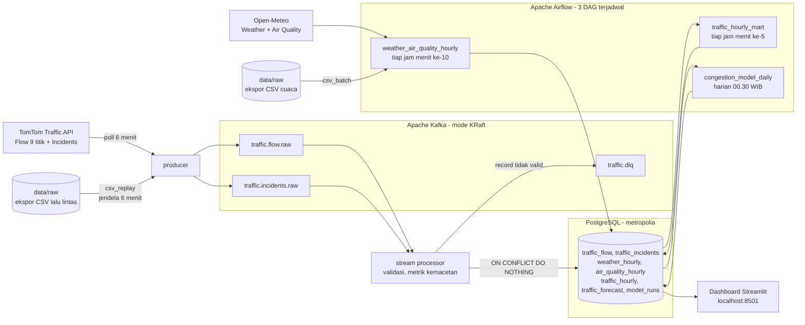

# Metropolia Smart Traffic — Sistem Analisis Big Data Smart City

Tugas Besar Analisis Big Data (Smart City Planning) — Kelompok 2, ITS.

**Kasus:** kota *Metropolia* (±750.000 penduduk) mengalami kemacetan parah pada jam sibuk.
Pemerintah kota ingin memperlancar arus lalu lintas, menurunkan polusi, dan meningkatkan
keselamatan berbasis data. Sistem ini memantau **3 koridor prioritas × 3 persimpangan kritis**
secara real-time, menggabungkannya dengan data cuaca & kualitas udara, lalu memprediksi
kemacetan 24 jam ke depan.

Metropolia direpresentasikan oleh **Surabaya** (koordinat nyata) agar seluruh data berasal
dari sumber asli.

## Daftar isi

- [Arsitektur](#arsitektur)
- [Struktur folder](#struktur-folder)
- [ETL Streaming (Kafka)](#etl-streaming-kafka)
- [ETL Batch (Airflow)](#etl-batch-airflow)
- [Mode simulasi dari CSV](#mode-simulasi-dari-csv)
- [Model prediktif](#model-prediktif)
- [Dashboard](#dashboard)
- [Cara menjalankan](#cara-menjalankan)
- [Pengujian](#pengujian)
- [Temuan dan keputusan teknis](#temuan-dan-keputusan-teknis)
- [Keterbatasan](#keterbatasan)
- [Catatan data](#catatan-data)
- [Daftar pustaka (IEEE)](#daftar-pustaka-ieee)

## Arsitektur

Pola lambda sederhana: dua jalur pemrosesan yang bermuara pada satu basis data.



| Service | Image | Port host | Fungsi |
|---|---|:---:|---|
| `kafka` | `apache/kafka:3.8.0` | 29092 | Penyangga pesan streaming, mode KRaft tanpa ZooKeeper |
| `kafka-init` | `apache/kafka:3.8.0` | – | Membuat ketiga topik sekali jalan lalu berhenti |
| `kafka-ui` | `provectuslabs/kafka-ui` | 8080 | Pemantauan topik, partisi, dan isi pesan |
| `postgres` | `postgres:16-alpine` | 5434 | Basis data `metropolia`, skema dimuat otomatis saat volume kosong |
| `producer` | `metropolia-etl-app` | – | Memanggil TomTom dan mengirim ke Kafka |
| `processor` | `metropolia-etl-app` | – | Validasi, transformasi, dan pemuatan ke PostgreSQL |
| `airflow` | `metropolia-airflow` | 8081 | Scheduler dan antarmuka web untuk 3 DAG batch |
| `dashboard` | `metropolia-etl-app` | 8501 | Visualisasi Streamlit |

Service `producer` dilewati saat memutar ulang CSV, agar data bersimulasi tidak bercampur dengan
baris berstempel jam sekarang.

## Struktur folder

| Folder | Isi |
|---|---|
| [ingestion/stream/](ingestion/stream/) | Producer Kafka, client TomTom, simulator, dan pemutar ulang CSV |
| [ingestion/batch/](ingestion/batch/) | Extract Open-Meteo dan pemuat batch dari CSV |
| [processing/stream/](processing/stream/) | Validasi, transform, metrik kemacetan, stream processor |
| [processing/batch/](processing/batch/) | Transform & validasi data Open-Meteo |
| [storage/](storage/) | Loader PostgreSQL + skema ([storage/schema/](storage/schema/)) |
| [modeling/](modeling/) | Model prediksi kemacetan (scikit-learn) |
| [dags/](dags/) | 3 DAG Airflow terjadwal |
| [dashboard/](dashboard/) | Dashboard Streamlit |
| [infrastructure/](infrastructure/) | Docker Compose, Dockerfile, template `.env` |
| [common/](common/) | Konfigurasi & daftar titik pantau |
| [tests/](tests/) | 66 unit test |

## ETL Streaming (Kafka)

**Extract** — [ingestion/stream/producer.py](ingestion/stream/producer.py) memanggil TomTom tiap 6 menit:

- *Flow Segment Data* untuk 9 titik pantau → kecepatan saat ini, kecepatan arus bebas, waktu tempuh.
- *Incident Details* untuk bounding box kota → kecelakaan, kemacetan, penutupan & perbaikan jalan.
- Data mentah dibungkus envelope `{kind, source, observed_at, ingested_at, payload}` dan dikirim ke Kafka
  (key = `point_id` / id insiden). Kuota gratis 2.500 request/hari: 10 request × 240 siklus = 2.400/hari.

**Transform** — [processing/stream/](processing/stream/):

- Validasi (field wajib, rentang kecepatan 0–200 km/jam, confidence 0–1, titik dikenal, waktu tidak di masa depan).
  Record tidak valid dikirim ke topik `traffic.dlq` beserta alasannya, bukan dibuang diam-diam.
- Enrichment: `speed_ratio = current/free_flow`, `congestion_index = 1 − speed_ratio`,
  `delay_seconds`, status **LANCAR** (≥ 0,8) / **PADAT** (0,5–0,8) / **MACET** (< 0,5) / **TUTUP**.
- Insiden dinormalisasi (kategori & tingkat keparahan dalam bahasa Indonesia, koordinat).

**Load** — [storage/stream_store.py](storage/stream_store.py): `traffic_flow` (insert idempoten dengan
`ON CONFLICT DO NOTHING`), `traffic_incidents` (upsert — insiden yang sama diperbarui selama masih aktif).
Offset Kafka di-commit **setelah** transaksi database sukses, sehingga jaminannya *at-least-once* dan
pemuatan idempoten membuat pengiriman ulang tidak menghasilkan duplikat.

## ETL Batch (Airflow)

Ketiganya dijalankan scheduler, bukan trigger manual.

| DAG | Jadwal | Isi |
|---|---|---|
| `weather_air_quality_hourly` | tiap jam, menit 10 | Extract Open-Meteo (2 hari lalu + 2 hari prakiraan) → validasi rentang fisik → upsert `weather_hourly` & `air_quality_hourly` → cek kesegaran data |
| `traffic_hourly_mart` | tiap jam, menit 5 | Cek streaming hidup → agregasi `traffic_flow` → `traffic_hourly` → cek rentang nilai & cakupan titik |
| `congestion_model_daily` | harian 00.30 WIB | Latih ulang model → simpan metrik ke `model_runs` → prakiraan 24 jam ke `traffic_forecast` |

View `mart_traffic_features` menggabungkan lalu lintas, cuaca, dan kualitas udara per jam, dan menjadi
dataset siap model. Join-nya memakai pasangan `(city, observed_hour)`, bukan jam saja — lihat
[Temuan dan keputusan teknis](#temuan-dan-keputusan-teknis).

`traffic_hourly_mart` memakai jendela **jam penuh** yang diturunkan dari `data_interval_end`:

```python
HOUR_END   = "date_trunc('hour', TIMESTAMPTZ '{{ data_interval_end }}')"
HOUR_START = f"({HOUR_END} - interval '1 hour')"
```

Jadwal `"5 * * * *"` membuat `data_interval` jatuh di menit ke-5, sedangkan agregasinya memakai
`date_trunc('hour', ...)`. Tanpa penguncian di atas, 5 menit pertama setiap jam tidak pernah ikut terhitung.

## Mode simulasi dari CSV

Menjalankan producer sungguhan membutuhkan Docker menyala terus-menerus selama berhari-hari untuk
mengumpulkan rentang waktu yang memadai. Agar demo dan pengujian tidak bergantung pada itu, ekspor CSV
dari basis data dapat diputar ulang melalui pipeline yang sama persis.

**Streaming** — [ingestion/stream/csv_replay.py](ingestion/stream/csv_replay.py) membaca
`data/raw/traffic_flow.csv` dan `data/raw/traffic_incidents.csv`, lalu mengirimkannya ke Kafka dalam
envelope yang identik dengan producer TomTom. Processor di hilirnya tidak perlu diubah: ia tetap
menghitung ulang `congestion_index` dari `current_speed` dan `free_flow_speed`.

Perbedaan pentingnya dengan producer biasa: `observed_at` diambil dari kolom timestamp CSV, **bukan jam
dinding**. Kalau ditimpa waktu sekarang, rentang historis ekspor akan runtuh menjadi sepanjang durasi
replay saja, dan ambang data latih model tidak akan pernah terpenuhi.

Posisi pemutaran disimpan di `data/.replay_state.json`, sehingga tiap pemanggilan melanjutkan dari tempat
berhenti — satu jendela masuk, dashboard diperiksa, lalu jendela berikutnya.

```bash
python -m ingestion.stream.csv_replay                # 1 jendela 6 menit lalu berhenti
python -m ingestion.stream.csv_replay --windows 60   # 6 jam data rekaman sekaligus
python -m ingestion.stream.csv_replay --all          # seluruh sisa CSV
python -m ingestion.stream.csv_replay --reset        # mulai lagi dari awal
python -m ingestion.stream.csv_replay --dry-run      # hitung saja, tanpa kirim dan tanpa simpan posisi
```

**Batch** — [ingestion/batch/csv_batch.py](ingestion/batch/csv_batch.py) memuat `weather_hourly.csv` dan
kualitas udara langsung ke PostgreSQL memakai fungsi upsert yang sudah ada di
[storage/batch_store.py](storage/batch_store.py), sehingga tidak ada SQL baru dan kunci
`(city, observed_hour)` tetap berlaku.

```bash
python -m ingestion.batch.csv_batch              # cuaca + kualitas udara
python -m ingestion.batch.csv_batch --dry-run    # hitung saja, tanpa menulis ke database
```

Urutannya penting: **muat cuaca lebih dulu**, karena mart menjodohkan lalu lintas dengan cuaca per jam.
Kalau dibalik, kolom suhu dan AQI akan kosong.

Karena data yang diputar ulang berstempel waktu masa lalu, agregasinya perlu backfill:

```bash
docker compose -f infrastructure/docker-compose.yml exec airflow \
  airflow dags backfill -s 2026-09-28T07:05:00+00:00 -e 2026-09-28T11:05:00+00:00 traffic_hourly_mart
```

Folder `data/` tidak ikut di-commit (lihat `.gitignore`); isi sendiri dengan hasil ekspor basis data.

## Model prediktif

[modeling/congestion_model.py](modeling/congestion_model.py) — `HistGradientBoostingRegressor`
memprediksi indeks kemacetan per titik per jam dari: titik pantau, jam (WIB), hari, akhir pekan, suhu,
kelembapan, curah hujan, angin, lag 1 jam, lag 24 jam, dan jumlah insiden aktif.

Evaluasinya memakai **time-series split** (20% data terbaru sebagai test, mencegah kebocoran data) dan
selalu dibandingkan dengan baseline rata-rata historis per (titik, jam). Metrik MAE, RMSE, dan MAE
baseline disimpan ke tabel `model_runs` setiap kali DAG berjalan.

Training ditolak jika data historis kurang dari **72 jam berbeda**:

```python
ABSOLUTE_MIN_TRAIN_HOURS = 48
MIN_TRAIN_HOURS = max(env_int("MIN_TRAIN_HOURS", 72), ABSOLUTE_MIN_TRAIN_HOURS)
```

Ambangnya dihitung dari jumlah **jam berbeda**, bukan jumlah baris: baris bertambah sebanyak titik pantau
setiap jam, sehingga ambang berbasis baris ikut berubah begitu jumlah titik berubah. Fitur `hour_of_day`,
`day_of_week`, dan `lag_24h` membutuhkan beberapa hari penuh; di bawah itu sebagian besar jam tidak pernah
terlihat saat training. Nilai dapat diturunkan lewat environment variable untuk keperluan demo, tetapi
tidak pernah di bawah 48 jam.

## Dashboard

http://localhost:8501 — KPI kota, peta kemacetan & insiden, tren per koridor, cuaca & kualitas udara
(aktual + prakiraan), korelasi kemacetan–PM2.5, serta prediksi kemacetan 24 jam dan performa model.

Seluruh query memakai parameter waktu acuan `:t_ref`, **bukan** `now()`. Sidebar menyediakan tiga mode:

| Mode | Perilaku |
|---|---|
| Data terbaru | Berlabuh pada stempel waktu terakhir di basis data — bawaan |
| Jelajah waktu | Slider untuk menggeser acuan ke jam mana pun dalam rentang data |
| Jam dinding | Memakai waktu sekarang |

Akibatnya dashboard tetap dapat dibaca dan ditelusuri setelah pengumpulan data berhenti, tanpa panel
kosong dan tanpa error.

## Cara menjalankan

Prasyarat: Docker Desktop.

1. Daftar API key gratis di https://developer.tomtom.com (menu *Dashboard → Keys*).
2. Konfigurasi dan jalankan:

```bash
make env     # membuat infrastructure/.env → isi TOMTOM_API_KEY, POSTGRES_PASSWORD, AIRFLOW_ADMIN_PASSWORD
make up      # build & jalankan seluruh stack
```

| Layanan | URL |
|---|---|
| Dashboard | http://localhost:8501 |
| Airflow (user `admin`, password dari `.env`) | http://localhost:8081 |
| Kafka UI | http://localhost:8080 |
| PostgreSQL | `localhost:5434` (db `metropolia`) |

```bash
make ps                                     # status service
make logs s=producer                        # log satu service
make dag-test d=weather_air_quality_hourly  # jalankan satu DAG sekali (debug)
make replay                                 # kirim satu jendela 6 menit dari CSV (w=60 untuk 60 jendela)
make replay-reset                           # mulai pemutaran CSV dari awal
make load-batch                             # muat cuaca & kualitas udara dari CSV
make down                                   # stop (data tetap ada)
make clean                                  # stop + hapus semua data
```

Untuk simulasi dari CSV, jalankan stack **tanpa** service `producer`, agar simulator tidak menyuntikkan
baris berstempel jam sekarang yang bercampur dengan data historis:

```bash
docker compose -f infrastructure/docker-compose.yml up -d \
  kafka kafka-init postgres processor airflow dashboard
```

> Tanpa API key, set `TRAFFIC_SOURCE=simulator` untuk menguji pipeline dengan data **sintetis**.
> Data simulator ditandai `source = 'simulator'` di basis data dan dashboard menampilkan peringatan.
> Untuk laporan atau demo dengan data nyata, gunakan `TRAFFIC_SOURCE=tomtom`.

> Airflow memakai port 8081. Jika port itu sudah dipakai proyek lain, hentikan dulu kontainernya atau
> ubah pemetaan port di `infrastructure/docker-compose.yml`.

## Pengujian

```bash
make venv && make test
```

Atau tanpa Airflow, cukup lima paket:

```bash
python -m venv .venv
.venv/bin/pip install pytest pandas scikit-learn confluent-kafka psycopg2-binary requests
.venv/bin/python -m pytest tests/ -q
```

**66 unit test**, mencakup:

| Berkas | Yang diuji |
|---|---|
| `test_tomtom_client.py` | Pemanggilan API, penanganan error, jaminan API key tidak bocor di pesan error |
| `test_traffic_transform.py` | Metrik kemacetan, klasifikasi level, validasi rentang |
| `test_incident_transform.py` | Normalisasi insiden, koordinat, kategori |
| `test_open_meteo_transform.py` | Transform & validasi data cuaca |
| `test_congestion_model.py` | Fitur waktu WIB, time-series split tanpa leakage, pola jam sibuk, batas prediksi 0–1, ambang jam |
| `test_traffic_hourly_mart_sql.py` | Penjaga regresi jendela agregasi DAG |
| `test_csv_replay.py` | Bentuk payload, pembagian jendela, posisi replay, parsing offset PostgreSQL |
| `test_csv_batch.py` | Bentuk baris cuaca & kualitas udara sebelum masuk basis data |

## Temuan dan keputusan teknis

Bagian ini mencatat masalah yang ditemukan beserta buktinya, agar keputusan desain dapat ditelusuri.

**Jendela agregasi tidak sejajar dengan jam.** DAG `traffic_hourly_mart` semula memakai
`data_interval_start`/`data_interval_end` apa adanya. Karena jadwalnya `"5 * * * *"`, jendelanya jatuh
pada 00.05–01.05 sedangkan `GROUP BY` memakai `date_trunc('hour', ...)`. Akibatnya 5 menit pertama setiap
jam tidak pernah terhitung dan pemeriksaan kualitas data memeriksa bucket yang salah. Pada ekspor
produksi, 180 dari 189 jam kehilangan tepat 10 sampel — dengan polling 30 detik, 10 sampel sama dengan
5 menit, yaitu **8,2% data terbuang diam-diam**. Setelah diperbaiki, jam yang terekam penuh menghasilkan
tepat 120 sampel (60 menit × 2 polling per menit).

**View lingkungan menggandakan baris.** Join antara lalu lintas dan cuaca semula hanya lewat jam,
padahal kunci `weather_hourly` dan `air_quality_hourly` adalah `(city, observed_hour)`. Dengan satu kota
hasilnya benar; begitu kota kedua masuk, setiap baris lalu lintas akan berlipat. Kolom `city` ditambahkan
ke `monitoring_points` dan join diperbaiki menjadi `(city, observed_hour)`.

**Dashboard mati setelah pengumpulan data berhenti.** Seluruh query memakai `now()`, sehingga ketika data
berumur beberapa hari, 4 dari 5 panel mengembalikan nol baris. Diganti dengan parameter `:t_ref`
dan tiga mode waktu acuan di sidebar.

**Ambang data latih berbasis baris menyesatkan.** Ambang lama 48 baris setara hanya sekitar 5 jam data
untuk 9 titik pantau. Diganti menjadi 72 jam berbeda, dengan batas bawah keras 48 jam.

**Data latih yang tersedia belum memadai.** Sesi pengumpulan menghasilkan 55 jam dari rentang 67 jam,
dengan satu celah 10 jam ketika stack mati. Diuji pada data tersebut dengan ambang diturunkan ke 48 jam,
model menghasilkan MAE 0,0803 berbanding baseline 0,0215 — **3,7 kali lebih buruk daripada rata-rata
historis sederhana**. Penyebabnya, variasi kemacetan pada data ini hampir seluruhnya antar-waktu
(simpangan baku 0,2007) dan nyaris nol antar-titik (0,0018), sehingga profil jam-hari sederhana sudah
hampir sempurna. Karena itu ambang 72 jam dipertahankan dan tab prediksi dibiarkan kosong sampai data
mencukupi, alih-alih menampilkan ramalan yang tidak dapat dipertanggungjawabkan.

## Keterbatasan

- Model belum dapat dilatih pada data yang tersedia saat ini; dibutuhkan minimal 72 jam data historis.
- Kualitas udara Open-Meteo berasal dari model CAMS dengan resolusi ±11 km, sehingga satu nilai mewakili
  seluruh kota dan tidak dapat dibedakan antar titik pantau.
- Pemutar ulang CSV memulihkan data lalu lintas dan insiden, tetapi jam-jam yang kosong pada rekaman asli
  tetap kosong; backfill harus dipecah mengikuti blok jam yang berisi.
- Data simulator bersifat sintetis dan tidak boleh disajikan sebagai hasil pengukuran TomTom.

## Catatan data

- Data lalu lintas, cuaca, dan kualitas udara diambil **live**, sehingga **tidak ada modifikasi timestamp**.
  `observed_at` = waktu polling (TomTom tidak mengirim timestamp untuk data flow).
- Koordinat titik pantau adalah perkiraan persimpangan di Surabaya; TomTom mengembalikan ruas jalan terdekat.
- Kolom `source` membedakan `tomtom` dan `simulator`, dan tidak pernah ditimpa di mana pun dalam pipeline.

## Daftar pustaka (IEEE)

[1] TomTom International B.V., "Traffic Flow API – Flow Segment Data," TomTom Developer Portal. [Online]. Available: https://developer.tomtom.com/traffic-api/documentation/traffic-flow/flow-segment-data. [Accessed: Sep. 28, 2026].

[2] TomTom International B.V., "Traffic Incidents API – Incident Details," TomTom Developer Portal. [Online]. Available: https://developer.tomtom.com/traffic-api/documentation/traffic-incidents/incident-details. [Accessed: Sep. 28, 2026].

[3] P. Zippenfenig, "Open-Meteo.com Weather API," Zenodo, 2023, doi: 10.5281/zenodo.7970649. [Online]. Available: https://open-meteo.com/en/docs. [Accessed: Sep. 28, 2026].

[4] Open-Meteo, "Air Quality API," Open-Meteo.com. [Online]. Available: https://open-meteo.com/en/docs/air-quality-api. [Accessed: Sep. 28, 2026].

[5] Copernicus Atmosphere Monitoring Service (CAMS), "CAMS global atmospheric composition forecasts," ECMWF. [Online]. Available: https://atmosphere.copernicus.eu. [Accessed: Sep. 28, 2026].
